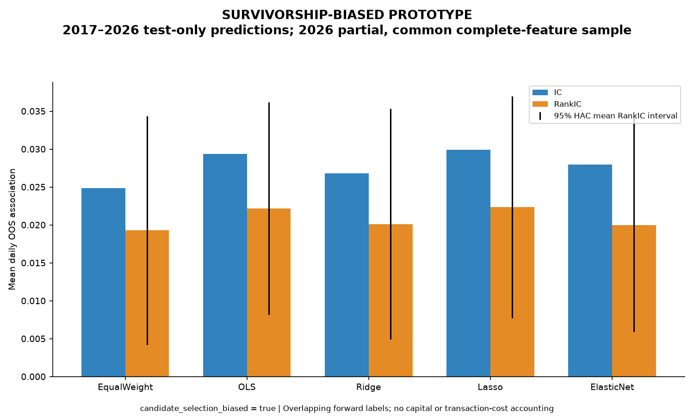
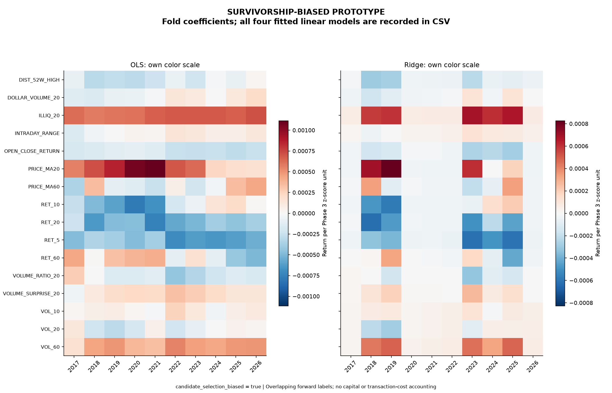

# Linear baseline research — test-only 5D predictions

**survivorship_biased = true; candidate_selection_biased = true**

Equal Weight OOS RankIC is 0.01931, versus the strongest raw-signed individual factor on the identical OOS sample, VOL_20 (0.01805). Thus Equal Weight exceeds that individual-factor ranking mean. Ridge has RankIC 0.02014, above Equal Weight. Lasso has the highest observed OOS RankIC (0.02238) among the five fixed baselines. These are observed comparisons, not proof that differences are statistically significant.

## Design fixed before results

Train starts in 2011. For test year Y=2017–2026, train ends in Y−2, validation is Y−1, and the test is Y. Labels ending at/after the next split start are purged from training and validation. No refit on validation. Phase 3 z-scores are unchanged; any extra scaler is trained only on training rows. Test feature predictions are saved even when the target is unavailable, with a separate label mask. All reported regression/IC metrics use the common available-label test sample.

The 16 inputs are all Phase 3 factors except exact inverse REV_5. No bad-performing factor is removed. Equal Weight signs are estimated separately from training-only daily RankIC and use equal weights in training-standardized feature units; an intercept/nonnegative slope is calibrated only on training data. OLS has no tuning. Ridge uses normalized lambdas [.001,.1,10]; Lasso/ElasticNet use [.00001,.0001,.001], fixed ElasticNet l1_ratio=.5. Selection uses validation RankIC, then MSE/stronger-penalty ties. All tried configurations and selections are saved.

## Combined OOS results

| model | observations | valid_dates | IC_mean | RankIC_mean | IC_IR | RankIC_IR | RankIC_hac_t | MSE | MAE | R2 |
|---|---|---|---|---|---|---|---|---|---|---|
| ElasticNet | 928158 | 2448 | 0.0279909 | 0.0200078 | 0.147986 | 0.101282 | 2.78475 | 0.00212525 | 0.0317902 | 0.000473 |
| EqualWeight | 928158 | 2448 | 0.0248572 | 0.0193064 | 0.11896 | 0.0910444 | 2.50902 | 0.00212533 | 0.03179 | 0.000438776 |
| Lasso | 928158 | 2448 | 0.0298962 | 0.022378 | 0.15305 | 0.108844 | 2.99999 | 0.00212491 | 0.0317879 | 0.000635715 |
| OLS | 928158 | 2448 | 0.0293762 | 0.0222028 | 0.152725 | 0.111022 | 3.10343 | 0.00212484 | 0.0317888 | 0.000668953 |
| Ridge | 928158 | 2448 | 0.0268344 | 0.0201354 | 0.127141 | 0.093954 | 2.59734 | 0.00212534 | 0.0317877 | 0.000430637 |

MSE/MAE use decimal-return units; R² compares against the pooled OOS target mean as a descriptive regression statistic, not a separately deployable benchmark. Ranking correlation is invariant to positive affine calibration, while squared error is sensitive to calibration and common market moves. Near-zero/negative R² can coexist with nonzero cross-sectional ranking information. No claim of a tradable edge follows.

## Year-by-year OOS RankIC

| year | ElasticNet | EqualWeight | Lasso | OLS | Ridge |
|---|---|---|---|---|---|
| 2017 | 0.016094 | 0.013707 | 0.0228456 | 0.0291818 | 0.0168594 |
| 2018 | 0.0145719 | 0.0169402 | 0.0255762 | 0.0228114 | 0.0228879 |
| 2019 | 0.0416487 | 0.0429228 | 0.0416119 | 0.0421953 | 0.0421344 |
| 2020 | 0.0138882 | 0.0165644 | 0.0147526 | 0.0133344 | 0.0126139 |
| 2021 | 0.0130803 | 0.0154686 | 0.0126217 | 0.0141106 | 0.0136381 |
| 2022 | -0.00719087 | -0.00221637 | -0.00662299 | -0.00763561 | -0.00897348 |
| 2023 | 0.0428385 | 0.0415147 | 0.0437106 | 0.0413817 | 0.0414479 |
| 2024 | 0.0136355 | 0.00685913 | 0.0142591 | 0.0131805 | 0.0134974 |
| 2025 | 0.0280519 | 0.0233502 | 0.0291662 | 0.0257895 | 0.0257522 |
| 2026 | 0.0248529 | 0.0176119 | 0.0273016 | 0.0297944 | 0.0221492 |

Each year is a distinct frozen test fold; 2026 is partial. These means can move materially across years even when the combined mean is positive. Full annual regression, HAC and IC metrics are retained; no unfavorable year is omitted.
All five models have negative mean RankIC in 2022; the stronger years include 2023, 2019. The aggregate positive association is not uniform across regimes. Calendar patterns alone do not establish their economic cause.

## Coefficient stability and sparse models

| model | coefficient_sign_changes | near_zero_factor_folds | largest_absolute_coefficient | most_variable_coefficient |
|---|---|---|---|---|
| ElasticNet | 7 | 62 | 0.000852278 | PRICE_MA20 |
| Lasso | 4 | 53 | 0.000673032 | PRICE_MA20 |
| OLS | 22 | 0 | 0.00111516 | RET_10 |
| Ridge | 31 | 0 | 0.000827373 | PRICE_MA20 |

OLS has 22 adjacent nonzero coefficient sign changes across the ten folds and maximum absolute loading 0.001115 per Phase 3 z-score unit. Its coefficients are not numerically explosive, but their signs vary. Ridge has 31 such changes; changing validation-selected penalties does not uniformly stabilize signs. Lasso adds 0.00307 mean OOS RankIC versus Equal Weight and 0.00018 versus OLS. ElasticNet has RankIC 0.02001, below Ridge. The gains are small and no paired difference significance is claimed; sparsity alone is not evidence of better generalization.

Sign changes count adjacent folds where both coefficients are nonzero; near-zero means absolute Phase 3 z-score coefficient <= 1e-8. OLS sensitivity is assessed by these coefficient magnitudes/sign changes and yearly outcomes, not assumed from its model name. Regularization reduces or zeroes some loadings, but Lasso/ElasticNet add value only to the extent their matched OOS rows outperform the transparent comparators above. Any observed advantage here is not an independent replication. Tables retain every coefficient, training scaler, EW orientation and selected parameter.

## Predefined group diagnostics

| feature_group | IC_mean | RankIC_mean | RankIC_hac_t | R2 | valid_dates |
|---|---|---|---|---|---|
| All | 0.0268344 | 0.0201354 | 2.59734 | 0.000430637 | 2448 |
| Liquidity_Volume | 0.0160284 | 0.00993707 | 2.37273 | 6.66205e-05 | 2448 |
| Momentum_Reversal | 0.0129207 | 0.0151557 | 2.37999 | -6.60702e-05 | 2448 |
| Price_Position_Intraday | 0.0215201 | 0.0142936 | 1.91301 | 0.000130137 | 2448 |
| Volatility | 0.0307436 | 0.0187212 | 1.94363 | 0.000431506 | 2448 |

All groups use identical complete-case samples, folds, targets and three-lambda Ridge grids. These diagnostic comparisons do not replace the predeclared all-factor Ridge model with the best-looking group. Momentum/Reversal excludes the exact sign duplicate; Price Position includes the two intraday features.

## Baseline for Phase 5

The **predeclared all-feature Ridge** remains the primary methodological benchmark: OOS IC 0.02683, RankIC 0.02014. The strongest observed simple comparator is **Lasso**, with RankIC 0.02238; future work should also report against it and Equal Weight, without claiming a post-selected comparator was preregistered. A complex model must be compared on the same folds, common sample and primary 5D target. No complex model is authorized or trained here.

Full-history single-factor results describe years that later appear in model tests. OOS means temporal fitting/tuning isolation under this frozen specification, not a never-inspected external holdout. Test targets, future fold rows and random row order were adversarially tested not to change earlier fits/predictions.

Daily 5D labels overlap, so IID t-statistics overstate precision when ICs are serially correlated. Primary inference uses Bartlett Newey-West lag 5, plus fixed lag-20 sensitivity, on the exchange-session grid. ICIR is unannualized mean/std. HAC does not remove universe bias or guarantee that a five-lag bandwidth captures all dependence. BH q-values separately cover the 17 primary IC and 17 primary RankIC tests; correlated factors, secondary horizons and researcher exposure still create multiple-testing/data-snooping concerns. No p-value alone establishes discovery.

These are conditional associations in a frozen current-member universe, not unbiased historical strategy evidence. Global candidate/quarantine selection, retrospective vendor revisions, unresolved identity/delistings and indicative adjusted-open prices remain. Risk/industry/size neutrality is not established. No transaction costs, auction-fill realism, borrow or overlapping-capital accounting are modeled.

Test predictions are separate per-fold Parquet artifacts with boundaries, model/group, target availability and source/protocol hashes. Analysis manifest, exact tried configurations, fold purge counts and coefficient tables are in phase4/.
